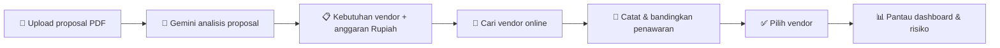
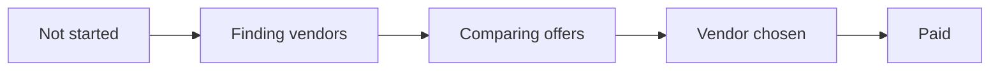

<a id="readme-top"></a>

<div align="center">

# 🎪 Venditores

### Pengadaan vendor acara, dari proposal PDF sampai hari H.

Aplikasi web untuk panitia acara yang membantu mengatur pengadaan vendor dari awal sampai acara selesai.

[![Laravel][Laravel-badge]][Laravel-url]
[![React][React-badge]][React-url]
[![TypeScript][TypeScript-badge]][TypeScript-url]
[![Tailwind CSS][Tailwind-badge]][Tailwind-url]
[![Gemini][Gemini-badge]][Gemini-url]

[![Website][Website-badge]][Website-url]

[**Fitur**](#-fitur) · [**Alur Kerja**](#-alur-kerja) · [**Menjalankan Project**](#-menjalankan-project) · [**Tim**](#-tim)

</div>

---
## 👥 Tim

| Nama | NIM | Branch |
|---|---|---|
| Wesley Goeinawan | 0706012410011 | `wes` |
| Angga Dhammika Jaya | 0706012410017 | `ang` |
| Keane Juan Suryanto | 0706012410004 | `kin` |

<details>
  <summary><b>📑 Daftar Isi</b></summary>
  <ol>
    <li><a href="#-tentang-project">Tentang Project</a></li>
    <li><a href="#-alur-kerja">Alur Kerja</a></li>
    <li>
      <a href="#-fitur">Fitur</a>
      <ul>
        <li><a href="#status-pengadaan">Status pengadaan</a></li>
        <li><a href="#status-penawaran">Status penawaran</a></li>
        <li><a href="#ai-matching">AI matching</a></li>
        <li><a href="#risiko">Risiko</a></li>
        <li><a href="#batas-pemakaian-ai">Batas pemakaian AI</a></li>
      </ul>
    </li>
    <li>
      <a href="#-menjalankan-project">Menjalankan Project</a>
      <ul>
        <li><a href="#prasyarat">Prasyarat</a></li>
        <li><a href="#instalasi">Instalasi</a></li>
        <li><a href="#konfigurasi-env">Konfigurasi .env</a></li>
        <li><a href="#akun-demo">Akun demo</a></li>
        <li><a href="#setelah-git-pull">Setelah git pull</a></li>
      </ul>
    </li>
    <li><a href="#-tim">Tim</a></li>
  </ol>
</details>

## 💡 Tentang Project

Panitia mengunggah **proposal PDF**, lalu **Google Gemini** menyusun daftar kebutuhan vendor beserta anggarannya. Setelah itu panitia mencari vendor, membandingkan penawaran, dan memantau risiko dari **dashboard**.

> 🎓 Project tugas akhir mata kuliah **Cloud Computing**, Universitas Ciputra.
>
> 🌐 Website: **[venditores.fsd.my.id][Website-url]**


## 🔄 Alur Kerja




## ✨ Fitur

| | Fitur | Penjelasan |
|:---:|---|---|
| 🔐 | **Akun** | Daftar, login, reset password, dan verifikasi email. |
| 📅 | **Event** | Buat, ubah, dan hapus event beserta proposal PDF (maks. 10 MB, disimpan privat). |
| 🤖 | **Analisis proposal** | Gemini membaca proposal lalu menulis ringkasan, skala acara, perkiraan peserta, dan kategori vendor beserta persentase anggaran. Persentase itu diubah menjadi Rupiah sehingga total alokasi selalu sama dengan anggaran event. |
| 📋 | **Kebutuhan vendor** | Tambah, ubah, hapus, dan tandai sebagai vital. |
| 🔎 | **Cari vendor online** | Tombol **"Find vendors online"** memakai Gemini dengan Google Search untuk mencari vendor sesuai kategori dan lokasi event, lengkap dengan harga perkiraan, kontak, website, dan sumbernya. Hasilnya bisa dijadikan penawaran lewat **"Add as quote"**. |
| 💬 | **Penawaran** | Catat manual atau dari hasil pencarian online, pilih dengan tombol **Choose**, atau tolak. |
| 🎯 | **AI matching** | Gemini menilai kecocokan penawaran dengan spesifikasi, sistem menilai kecocokan harga dengan anggaran. |
| ⏰ | **Risiko** | Dihitung dari sisa hari menuju acara, tanpa AI. |
| 📊 | **Dashboard** | Jumlah event, kebutuhan vendor, penawaran, total anggaran, status pipeline, kebutuhan kritis, dan peringatan risiko. |

### Status pengadaan



Status berubah otomatis saat panitia bekerja dengan penawaran, kecuali **Paid** yang diatur manual. Tombol **"What do the statuses mean?"** menjelaskan arti tiap status.

### Status penawaran

| Status | Arti |
|---|---|
| 🟡 **Under review** | Penawaran sedang dipertimbangkan |
| 🟢 **Chosen** | Vendor dipilih |
| 🔴 **Declined** | Penawaran ditolak |

### AI matching

```
skor akhir = 60% kecocokan spesifikasi (Gemini) + 40% kecocokan anggaran (sistem)
```

### Risiko

| Level | Sisa hari menuju acara |
|---|---|
| 🔴 **Urgent** | 30 hari atau kurang |
| 🟠 **Warning** | 60 hari atau kurang |
| 🟢 **Low** | lebih dari 60 hari |

### Batas pemakaian AI

Per pengguna, per menit:

| Fitur | Batas |
|---|---|
| Analisis proposal | 5 kali |
| AI matching | 10 kali |
| Pencarian vendor | 10 kali |


## 🚀 Menjalankan Project

### Prasyarat

- **PHP 8.3** atau lebih baru, dengan ekstensi `pdo_sqlite`, `sqlite3`, `mbstring`, `openssl`, `fileinfo`, `curl`
- **Composer 2**
- **Node.js 22**
- **Git**

### Instalasi

```bash
git clone https://github.com/WesleyGoey/Venditores.git
cd Venditores
git switch kin                   # atau wes / ang

composer install
npm install

cp .env.example .env
php artisan key:generate

touch database/database.sqlite
php artisan migrate
php artisan db:seed              # opsional, data demo

composer run dev
```

Buka 👉 **http://127.0.0.1:8000**

### Konfigurasi `.env`

| Variabel | Keterangan |
|---|---|
| `GEMINI_API_KEY` | Tanpa key, hanya fitur AI yang tidak jalan. |
| `MAIL_MAILER=log` | Email tidak dikirim, link verifikasi ada di `storage/logs/laravel.log`. |

> ⚠️ Jangan commit file `.env` ke GitHub.

### Akun demo

Tersedia setelah `php artisan db:seed`. Seeder ini hanya untuk lokal.

| Email | Password |
|---|---|
| `test@example.com` | `password` |

### Setelah `git pull`

```bash
composer install
npm install
php artisan migrate
```


<!-- MARKDOWN LINKS & IMAGES -->
[Laravel-badge]: https://img.shields.io/badge/Laravel-FF2D20?style=for-the-badge&logo=laravel&logoColor=white
[Laravel-url]: https://laravel.com
[React-badge]: https://img.shields.io/badge/React-20232A?style=for-the-badge&logo=react&logoColor=61DAFB
[React-url]: https://react.dev
[TypeScript-badge]: https://img.shields.io/badge/TypeScript-3178C6?style=for-the-badge&logo=typescript&logoColor=white
[TypeScript-url]: https://www.typescriptlang.org
[Tailwind-badge]: https://img.shields.io/badge/Tailwind_CSS-06B6D4?style=for-the-badge&logo=tailwindcss&logoColor=white
[Tailwind-url]: https://tailwindcss.com
[Gemini-badge]: https://img.shields.io/badge/Google_Gemini-8E75B2?style=for-the-badge&logo=googlegemini&logoColor=white
[Gemini-url]: https://ai.google.dev
[Website-badge]: https://img.shields.io/badge/🌐_Kunjungi_Website-venditores.fsd.my.id-0A66C2?style=for-the-badge
[Website-url]: https://venditores.fsd.my.id
